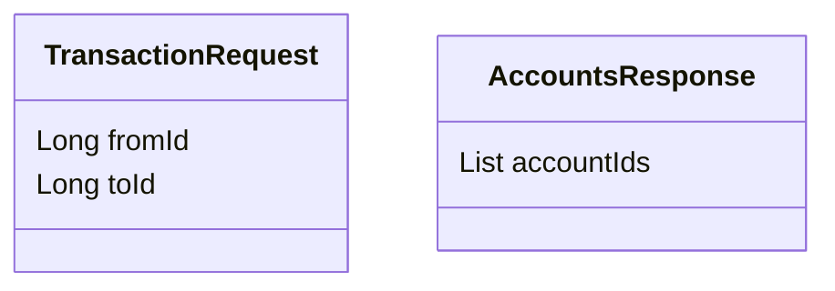

| function         | method                      | body               | response         |
| ---------------- | --------------------------- | ------------------ | ---------------- |
| create           | POST /api/v1/account/create | -                  | accountId        |
| get all accounts | GET /api/v1/account/        | -                  | AccountsResponse |
| transaction      | POST /api/v1/transaction/   | TransactionRequest | -                |

